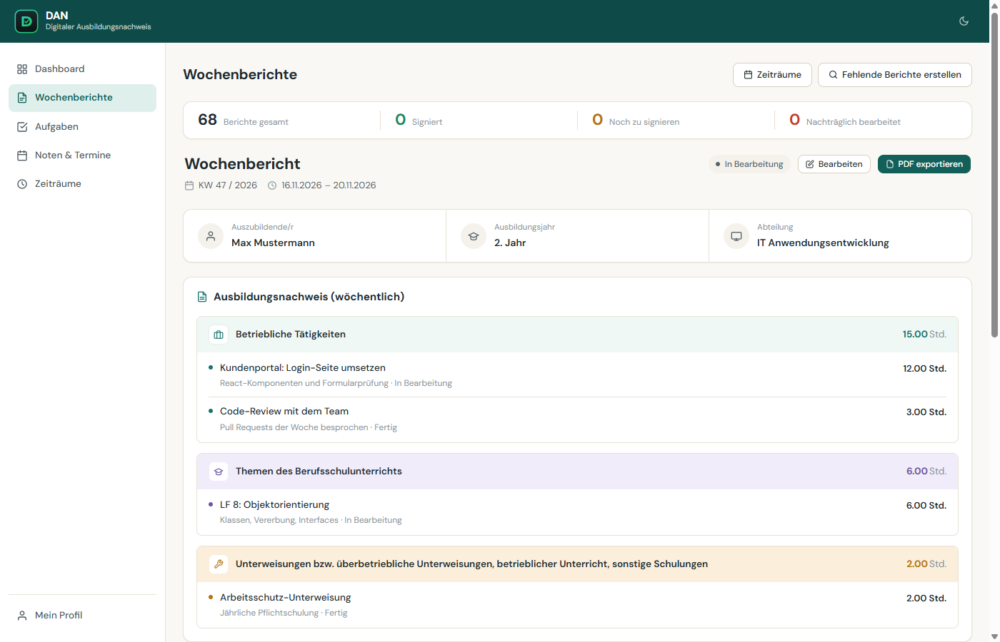
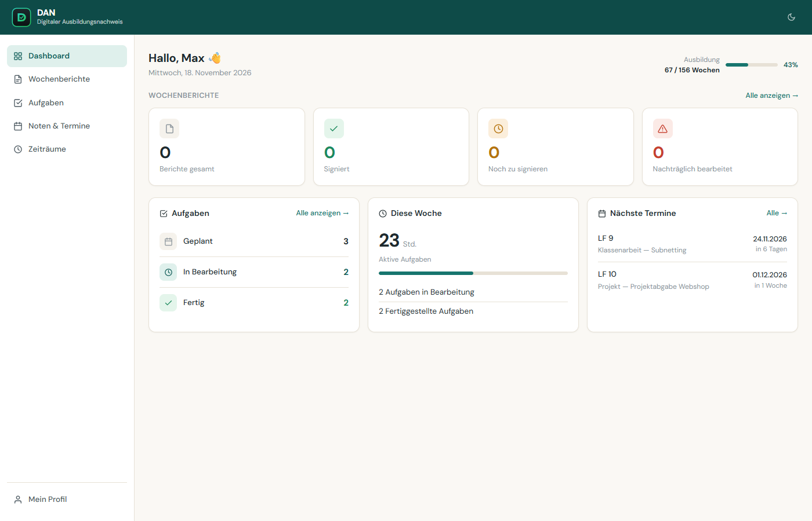
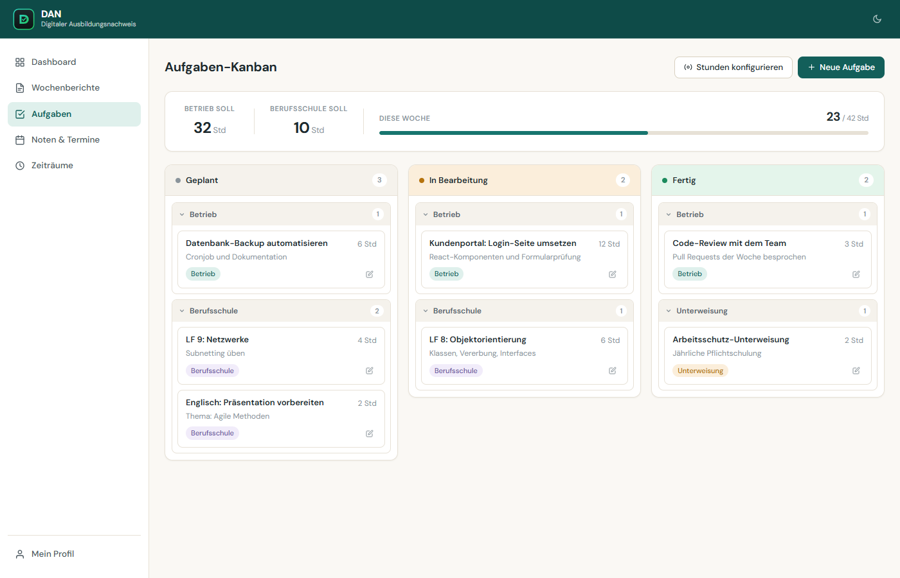
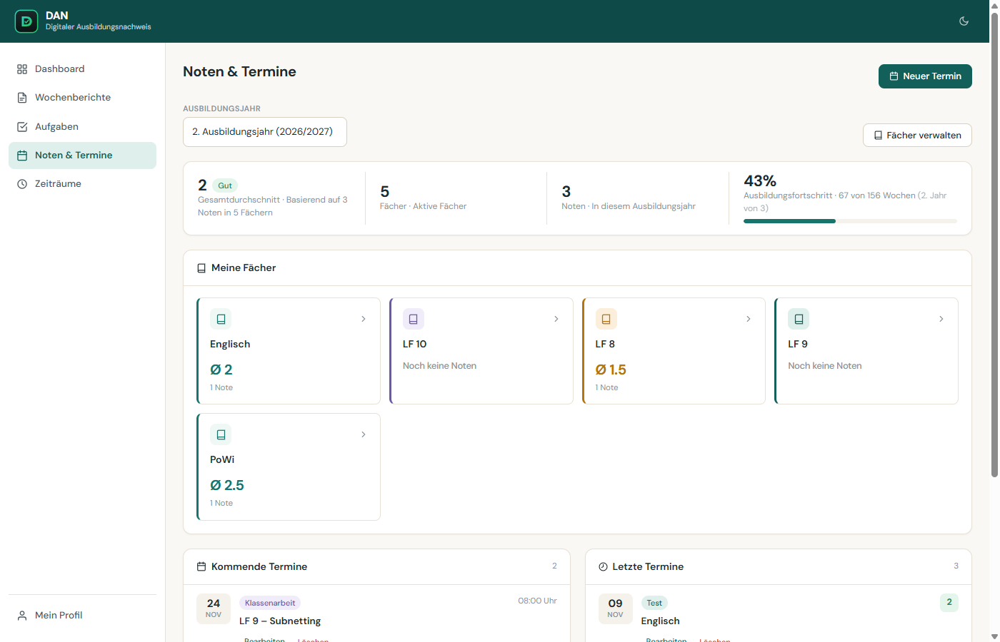
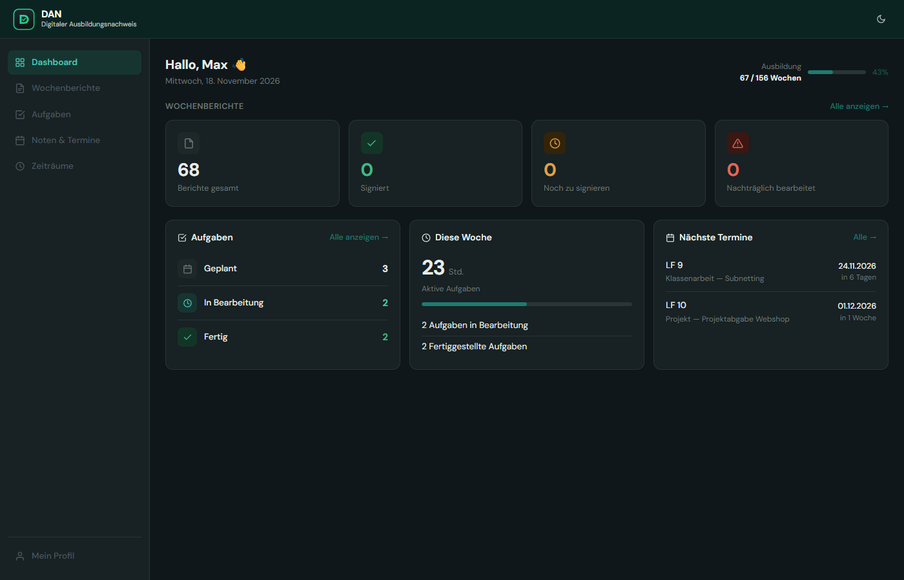

<p align="center">
  
</p>

<h1 align="center">DAN</h1>

<p align="center"><strong>Dein digitaler Ausbildungsnachweis – Wochenberichte, Aufgaben und Noten an einem Ort.</strong><br>
<em>Lokal. Schnell. Ohne Server.</em></p>

<p align="center">
  <a href="https://github.com/CaseyMazey/DAN/releases/latest/download/DAN-Setup.exe"></a>
  <a href="#macos"></a>
  <a href="#linux"></a>
</p>

<p align="center">
  <a href="https://github.com/CaseyMazey/DAN/releases/latest"></a>
  
  
  
</p>

<p align="center">
  
</p>

Du schreibst deinen Ausbildungsnachweis noch in Word oder auf Papier? **DAN macht daraus ein paar Klicks.**

Du sammelst unter der Woche deine Aufgaben auf einem Kanban-Board. DAN baut daraus automatisch deinen Wochenbericht, rechnet die Stunden zusammen und gibt ihn als **offiziellen IHK-Nachweis als PDF** aus – mit deiner Unterschrift.

- 🔒 **Ohne Konto, ohne Server.** DAN läuft komplett auf deinem Rechner, deine Daten verlassen ihn nie.
- ⚡ **Startet mit einem Klick.** Kein XAMPP, kein PHP, keine Datenbank zum Einrichten.
- 💾 **Deine Daten gehören dir.** Eine Sicherungsdatei, und du ziehst mit allem auf einen anderen Rechner um.

## Installieren

DAN gibt es für Windows, macOS und Linux, direkt hier von GitHub.

### Windows

1. **[DAN-Setup.exe herunterladen](https://github.com/CaseyMazey/DAN/releases/latest/download/DAN-Setup.exe)** (Windows 10/11).
2. Die Datei ausführen. DAN installiert sich für deinen Benutzer, ohne Admin-Rechte, mit Verknüpfung auf dem Desktop und im Startmenü.
3. Erscheint „Der Computer wurde durch Windows geschützt“: auf **Weitere Informationen → Trotzdem ausführen** klicken. Die Meldung kommt, weil das Setup nicht signiert ist.

**Update:** Neue Version herunterladen und ausführen, deine Daten bleiben erhalten. Deinstallieren geht über Einstellungen → Apps, die Daten bleiben auch dabei erhalten.

### macOS

1. Herunterladen, passend zu deinem Mac (Apfel-Menü → Über diesen Mac):
   - **[Apple Silicon (M1, M2, M3 …)](https://github.com/CaseyMazey/DAN/releases/latest/download/DAN-mac-arm64.dmg)**
   - **[Intel](https://github.com/CaseyMazey/DAN/releases/latest/download/DAN-mac-x64.dmg)**
2. Die `.dmg` öffnen und **DAN in den Ordner „Programme“ ziehen**.
3. **Beim ersten Öffnen** blockiert macOS die App, weil sie nicht über ein kostenpflichtiges Apple-Entwicklerkonto signiert ist. So öffnest du sie trotzdem:
   - **Rechtsklick** auf DAN → **Öffnen** → **Öffnen**.
   - Klappt das nicht (macOS 15 und neuer): **Systemeinstellungen → Datenschutz & Sicherheit**, nach unten scrollen, bei DAN auf **„Dennoch öffnen“** klicken.
   - Meldet macOS, die App sei **„beschädigt“**: Terminal öffnen und `xattr -dr com.apple.quarantine /Applications/DAN.app` eingeben, danach normal öffnen.

**Update:** Neue Version herunterladen und wieder in „Programme“ ziehen. Deine Daten bleiben erhalten.

### Linux

- **Debian, Ubuntu, Mint …:** **[DAN-linux-amd64.deb](https://github.com/CaseyMazey/DAN/releases/latest/download/DAN-linux-amd64.deb)** herunterladen und installieren:
  ```bash
  sudo apt install ./DAN-linux-amd64.deb
  ```
- **Alle anderen (Fedora, Arch …):** **[DAN-linux-x86_64.AppImage](https://github.com/CaseyMazey/DAN/releases/latest/download/DAN-linux-x86_64.AppImage)** herunterladen, ausführbar machen und starten:
  ```bash
  chmod +x DAN-linux-x86_64.AppImage && ./DAN-linux-x86_64.AppImage
  ```

## So sieht DAN aus

### Dashboard

Alles auf einen Blick: offene Signaturen, deine Aufgaben, die Stunden der Woche und die nächsten Klassenarbeiten.

<p align="center"></p>

### Aufgaben-Kanban

Aufgaben anlegen, per Drag & Drop von „Geplant“ über „In Bearbeitung“ nach „Fertig“ ziehen. Was diese Woche läuft, landet automatisch im Wochenbericht. DAN zeigt dir, ob du dein Stunden-Soll erreichst.

<p align="center"></p>

### Wochenberichte und IHK-PDF

- Der Bericht der laufenden Woche entsteht live aus deinen Aufgaben.
- **Abgeben, signieren, als PDF exportieren** – auf der offiziellen IHK-Vorlage, einzeln oder als Sammel-PDF für mehrere Wochen.
- Nachträgliche Änderungen werden mit Kommentar protokolliert.
- Fehlende Wochen seit Ausbildungsbeginn legt DAN von selbst an.
- **Zeiträume** wie Urlaub, Krankheit oder Praktikum tragen sich automatisch in die betroffenen Wochen ein und kürzen die Soll-Stunden.

### Noten & Termine

Fächer pro Ausbildungsjahr, Klassenarbeiten und Tests mit Datum und Uhrzeit, Noten mit Durchschnitt pro Fach und insgesamt.

<p align="center"></p>

### Hell und dunkel

<p align="center"></p>

## Deine Daten

DAN speichert alles in einem Ordner auf deinem Rechner:

| System | Ordner |
|---|---|
| Windows | `%APPDATA%\DAN\daten` |
| macOS | `~/Library/Application Support/DAN/daten` |
| Linux | `~/.config/DAN/daten` |

**Sichern und umziehen:** In DAN unter **Mein Profil → Datensicherung** lädst du eine `.dan`-Datei herunter (alle Berichte, Aufgaben, Noten und deine Unterschrift). Auf einem neuen Rechner wählst du sie direkt bei der Einrichtung unter „Schon eine DAN-Sicherung?“ aus. Sicherungen funktionieren zwischen Windows, macOS und Linux.

## Gut zu wissen

- **Keine Anmeldung:** DAN öffnet sich direkt. Geschützt wird es durch dein Benutzerkonto am Rechner.
- **Sicher trotz lokalem Server:** Intern läuft DAN als kleiner Server auf `127.0.0.1`. Er nimmt nur Anfragen aus dem DAN-Fenster an (zufälliger Schlüssel bei jedem Start); andere Programme und Webseiten kommen nicht an deine Daten.
- **Offline:** DAN braucht kein Internet, auch die Schrift ist eingebaut.
- **Die Vorwoche** wird beim Öffnen automatisch abgegeben, falls du es vergessen hast.

## Für Entwickler

```bash
npm install
npm start            # App im Entwicklungsmodus starten
npm test             # Tests
npm run dist:win     # Installer bauen (dist:mac auf einem Mac, dist:linux unter Linux)
node scripts/start-check.js dist/win-unpacked/DAN.exe   # gebaute App starten und prüfen
node scripts/dev-server.js   # nur Server, im Browser unter http://127.0.0.1:8123 (Testdaten in .devdata)
npx electron scripts/screenshots.js   # README-Screenshots mit Beispieldaten neu erzeugen
npx electron scripts/make-icon.js     # alle Icons aus build/icon.svg erzeugen
```

Aufbau:
- `src/main.js`: Electron-Fenster; startet den lokalen Server auf 127.0.0.1
- `src/server/`: Express-Server, SQLite (eingebautes `node:sqlite`), Fachlogik, PDF (pdf-lib), Datensicherung
- `src/views/`: EJS-Vorlagen
- `src/public/`: CSS/JS/Schriften, `src/resources/`: IHK-Vorlage und Fenster-Icon

**Neue Version veröffentlichen:** Version in `package.json` erhöhen, committen, dann `git tag v<version>` und `git push --tags`. GitHub Actions baut DAN auf Windows, macOS und Linux und legt das Release mit allen Installern an. Bei jedem Push auf `main` laufen die Tests auf allen drei Systemen, dazu ein Probe-Build mit Startprüfung.

**Daten aus DAN2 (Laravel) übernehmen:** Mit laufendem XAMPP-MySQL `node scripts/import-dan2.js --azubi <ID> --ziel <Ordner>` ausführen, daraus eine `.dan`-Sicherung machen und diese in DAN wiederherstellen.
